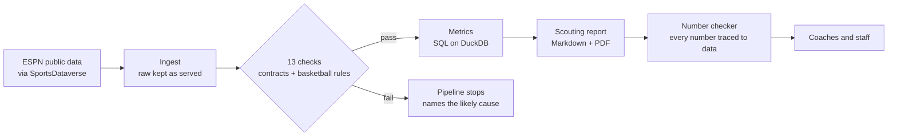
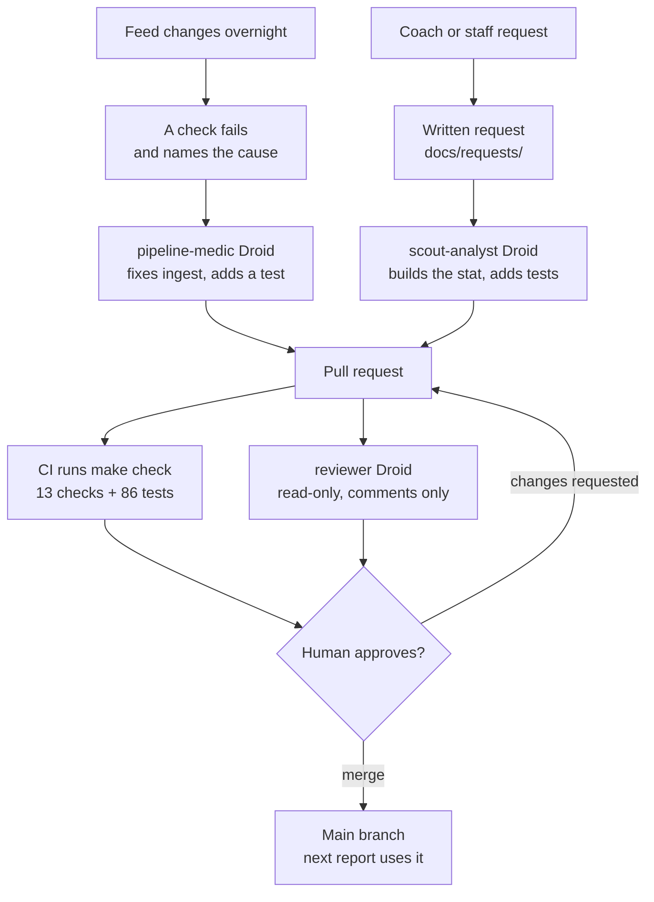

# Valkyries scouting factory

An automated opponent scouting report for the Golden State Valkyries, maintained by
[Factory](https://factory.ai) Droids.

> Data: ESPN via [SportsDataverse](https://github.com/sportsdataverse)

## What it does

1. **Ingest** the 2026 WNBA season (play-by-play, box scores, schedule). Raw files are kept
   exactly as served, and normalization happens on the way to `data/clean/`.
2. **Validate** with data contracts plus basketball invariants. The key one: play-by-play
   points must sum to the box score for every team in every game (706 of 706 pass).
3. **Compute** ratings, four factors, shot zones, clutch, top players and head-to-head in SQL.
4. **Report** to Markdown + PDF. Every number goes through a ledger, and
   `check_report` proves no number in the text was typed by hand or invented by a model.
   Keys are split into “When they have the ball” (our defensive priorities) and
   “When we have the ball” (our offensive priorities), with up to three qualifying keys each.
5. **Maintain itself.** When the feed breaks or a staffer asks for a new stat, a Droid opens
   the fix as a PR, and nothing merges unless `make check` passes. See
   [How it maintains itself](#how-it-maintains-itself) for the real examples.

## Architecture



| Layer | Tool | Why |
|---|---|---|
| Data | ESPN via SportsDataverse | Free, public, full 2026 season |
| Storage | Parquet files | Raw copy untouched; clean copy is what the code reads |
| Compute | Python + DuckDB | One season fits on a laptop, so no warehouse needed |
| Report | ReportLab | PDF a coach can print |
| Quality gates | pytest, ruff, mypy strict, pre-commit, gitleaks | Run on every change through `make check` |
| CI | GitHub Actions | `make check` plus a Droid review on every PR, and a nightly data check |
| Agents | Factory Droids | Do the code changes; a human approves every merge |

The checks live in the code (`scout/validate.py`, `scout/contracts.py`), not in any Droid.
Every Droid has to pass them, and the rules forbid weakening them.

## How it maintains itself



**Guardrails:** `AGENTS.md` is the rulebook every Droid reads; a hook blocks any Droid from
editing `data/raw/`; the reviewer can only comment, never edit; and nothing merges without a
human.

### Real examples from this repo

| PR | What triggered it | Droid | What it did | What the review loop caught |
|---|---|---|---|---|
| [#1](https://github.com/codergal1234/valkyries-scouting/pull/1) | First run of the repo | Default Droid | Found that installs failed on locked-down Python; set up a project `.venv` and pinned versions | Fix verified from a fresh clone |
| [#11](https://github.com/codergal1234/valkyries-scouting/pull/11) | Feed renamed `score_value` and `scoring_play` (simulated upstream change) | pipeline-medic | Mapped the new names back in `scout/ingest.py`, added a regression test, clarified the raw-data rule | Reviewer flagged an outdated demo guide and a coverage floor to raise; both fixed before merge |
| [#12](https://github.com/codergal1234/valkyries-scouting/pull/12) | Staff request for transition offense and defense | scout-analyst | New Transition section: Atlanta scores 20.7% of its points in transition, 1st in the league | Three review rounds: a rounding bug at exactly 8 seconds, out-of-bounds rebounds, a missing data contract, technical-foul free throws. A rare lane-violation case was logged as a follow-up. |
| [#13](https://github.com/codergal1234/valkyries-scouting/pull/13) | Staff read the report: offense advice under a defense heading, and jargon in the Transition note | scout-analyst | Split keys into "When they have the ball" and "When we have the ball"; rewrote the note in coach language | A human reading the report caught what no test could |

## Results so far

- **Sample report:** [Finals Game 7 prep vs. Atlanta](reports/ATL_2026-10-31.pdf), built only from
  games played before Game 7. A [first-round replay vs. Dallas](reports/DAL_2026-09-27.pdf) shows the same
  pipeline at a different date.
- **Agent Readiness: Level 2 (25%) to Level 3 (55%)**, measured with Factory's `/readiness-report`.
  Every improvement shipped as a Droid-authored pull request that a human reviewed and merged
  (#1 to #6): reproducible setup, ruff, strict mypy, pre-commit with secret scanning, a coverage
  gate, and GitHub templates.
- **On its first run, the Droid found a setup bug** (installs failing on externally managed Python)
  and fixed it in PR #1.

## Quickstart

```bash
make setup            # creates .venv/ and installs the pinned requirements.txt into it
make check            # ingest + 13 data checks + tests + report number check
make report OPP=ATL   # reports/ATL_2026-10-31.md and .pdf (Finals Game 7 prep)
make report OPP=DAL ASOF=2026-09-27   # replay: first-round prep, using only earlier games
```

Every target runs `.venv/bin/python`. To use another interpreter, pass `PY=`, for example
`make setup check PY=/path/to/python`.

## How Factory is wired in

| Piece | File |
|---|---|
| Project rules and commands for agents | `AGENTS.md` |
| Fixes upstream breakage without weakening checks | `.factory/droids/pipeline-medic.md` |
| Turns staff requests into metrics | `.factory/droids/scout-analyst.md` |
| Read-only PR review | `.factory/droids/reviewer.md` |
| Repeatable recipe for a new stat | `.factory/skills/new-metric/SKILL.md` |
| Hook: Droids can't write to `data/raw/` | `.factory/hooks.json` |
| CI: `make check` + Droid review on every PR, nightly validate | `.github/workflows/check.yml` |

See `DEMO.md` for the two live loops.
